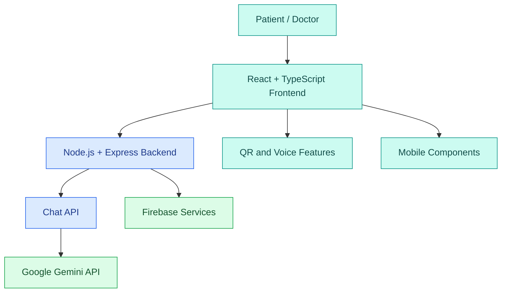

# 🏥 MedicalAI
### AI-Assisted Clinical Intelligence & Preliminary Triage

**Smarter Care, Better Access.**

An AI-assisted healthcare platform designed to make preliminary health information easier to access and understand. MedicalAI brings together AI-powered health conversations, patient and doctor portals, multilingual accessibility, patient information workflows, and web/mobile project components in one platform.

<p align="left">
  
  
  
  
  
  
  
</p>

<p align="left">
  
  
  
</p>

<p align="left">
  <a href="https://github.com/uiaryanyadav1109-dev/MedicalAI">
    
  </a>
  <a href="https://github.com/uiaryanyadav1109-dev/MedicalAI/forks">
    
  </a>
  <a href="https://github.com/uiaryanyadav1109-dev/MedicalAI/issues">
    
  </a>
  <a href="https://github.com/uiaryanyadav1109-dev/MedicalAI/pulls">
    
  </a>
</p>

**[GitHub Repository](https://github.com/uiaryanyadav1109-dev/MedicalAI) · [Live Demo](https://medicalai-1.onrender.com/)**

---

## 📌 Table of Contents

- [About the Project](#-about-the-project)
- [Live Demo](#-live-demo)
- [Features](#-features)
- [Tech Stack](#-tech-stack)
- [System Architecture](#-system-architecture)
- [Project Structure](#-project-structure)
- [Pages and Modules](#-pages-and-modules)
- [Quick Start](#-quick-start)
- [Environment Variables](#-environment-variables)
- [Running the App](#-running-the-app)
- [API Reference](#-api-reference)
- [Security and Privacy](#-security-and-privacy)
- [Future Scope](#-future-scope)
- [Contributing](#-contributing)
- [Medical Disclaimer](#-medical-disclaimer)

---

## 🏥 About the Project

Healthcare information can be difficult to understand, language barriers can limit access, and patient information may be spread across different systems.

**MedicalAI** explores how artificial intelligence and full-stack development can help address these challenges through a unified digital healthcare experience.

The project focuses on accessible health information, AI-assisted conversations, patient-oriented workflows, and doctor-facing interfaces.

### 🎯 Project Goals

- Make preliminary health information easier to understand.
- Explore AI-assisted healthcare conversations.
- Support multilingual and voice-based accessibility.
- Organize patient information through digital workflows.
- Build a foundation for web and mobile healthcare experiences.

## 🌐 Live Demo

- **Website:** https://medicalai-1.onrender.com/
- **Source Code:** https://github.com/uiaryanyadav1109-dev/MedicalAI

*Some features may require configuration or may still be under development. Verify the current deployment before relying on individual features.*

## ✨ Features

| Feature | Description |
|---|---|
| 🤖 AI Medical Chatbot | AI-assisted preliminary health information |
| 🩺 Patient Portal | Patient-facing profile and information workflows |
| 👨‍⚕️ Doctor Portal | Doctor-oriented interface |
| 🌐 Multilingual Support | Targeted support for English, Hindi, Bengali, and Hinglish |
| 🔊 Voice Assistance | Read-aloud and voice-related accessibility features |
| 🪪 Digital Patient ID | Patient identification and QR-code workflows |
| 🔐 Authentication | Firebase-based authentication where configured |
| 🚨 Emergency Workflow | Interface for emergency-related functionality |
| 💊 Medicine Reminders | Planned or implemented medication reminder workflows, depending on current build |
| 📱 Mobile Components | Android and iOS project components |
| 🌙 Responsive UI | User interface designed for different screen sizes |

## 🛠️ Tech Stack

| Technology | Purpose |
|---|---|
| React | Frontend user interface |
| TypeScript | Typed application development |
| Vite | Frontend development and build tooling |
| Node.js | Backend JavaScript runtime |
| Express.js | Backend API and server |
| Google Gemini API | AI-powered conversations |
| Firebase | Authentication and data services, where configured |
| Tailwind CSS | UI styling |
| Lucide React | Icons |
| Motion | Interface animations |
| QRCode libraries | QR-code generation |
| Git and GitHub | Version control and collaboration |
| Render | Deployment configuration |

## 🏗️ System Architecture



## 📂 Project Structure

```text
MedicalAI/
├── src/             # Frontend application source
├── public/          # Static assets
├── docs/            # Project documentation
├── scripts/         # Utility scripts
├── android/         # Android project files
├── ios/             # iOS project files
├── mobile-app/      # Mobile-related code
├── server.ts        # Express server entry point
├── package.json     # Dependencies and scripts
├── vite.config.ts   # Vite configuration
├── Dockerfile       # Container configuration
└── render.yaml      # Render deployment configuration
```

## 🧭 Pages and Modules

The intended application experience includes the following modules. Availability depends on the current implementation.

- **Landing Page:** Project introduction and entry point.
- **Authentication:** Registration and sign-in.
- **Patient Dashboard:** Patient-facing features and information.
- **Doctor Portal:** Doctor-oriented workflows.
- **AI Chat:** Preliminary health information and AI conversations.
- **Patient ID and QR:** Patient identification and information-sharing workflows.
- **Voice Accessibility:** Read-aloud and voice-related functionality.
- **Emergency Workflow:** Emergency-related interface and support features.
- **Mobile Experience:** Android and iOS project components.

## ⚡ Quick Start

### Prerequisites

Install the following before starting:

- [Node.js](https://nodejs.org/) — use a version compatible with the project.
- npm
- [Git](https://git-scm.com/)
- Firebase project configuration, if required.
- Google Gemini API key for AI functionality.

### 1. Clone the repository

```powershell
git clone https://github.com/uiaryanyadav1109-dev/MedicalAI.git
cd MedicalAI
```

### 2. Install dependencies

```powershell
npm ci
```

### 3. Create the environment file

```powershell
Copy-Item .env.example .env
```

### 4. Configure the required variables

Add the appropriate Firebase and AI settings to `.env`, following the project's environment-variable names.

### 5. Start the development server

```powershell
npm run dev
```

## 🔑 Environment Variables

The exact variables depend on the current source code and deployment configuration.

| Variable | Purpose |
|---|---|
| `VITE_FIREBASE_API_KEY` | Firebase web configuration |
| `VITE_FIREBASE_AUTH_DOMAIN` | Firebase Authentication domain |
| `VITE_FIREBASE_PROJECT_ID` | Firebase project identifier |
| `VITE_FIREBASE_STORAGE_BUCKET` | Firebase Storage configuration |
| `VITE_FIREBASE_MESSAGING_SENDER_ID` | Firebase messaging configuration |
| `VITE_FIREBASE_APP_ID` | Firebase web application identifier |
| `GEMINI_API_KEY` | Server-side Google Gemini API key |

**Important:**
- Frontend variables prefixed with `VITE_` are exposed to browser code. Do not put private server secrets in them.
- Keep `GEMINI_API_KEY` on the backend.
- Never commit `.env` files containing secrets.
- Check `.env.example` and the application source for the actual required variable names.

## ▶️ Running the App

Start development:

```powershell
npm run dev
```

Build the application:

```powershell
npm run build
```

Start the production-style server:

```powershell
npm start
```

These commands assume the corresponding scripts exist in `package.json`. If a command is unavailable, inspect the `scripts` section and use the configured command.

### Health Check

If the backend exposes a health endpoint, open:

```text
http://localhost:<PORT>/health
```

Replace `<PORT>` with the port configured for the backend.

## 🔌 API Reference

The Express backend is intended to handle application APIs and AI chat requests.

| Endpoint | Purpose |
|---|---|
| `GET /health` | Backend health check, if configured |
| `/api/*` | Application API routes, including chat-related routes where configured |

Check `server.ts` and the actual route files for complete endpoint paths, HTTP methods, request bodies, and response formats.

## 🔐 Security and Privacy

- Use authentication and server-side authorization for protected data.
- Restrict access to patient information based on the user's role and permissions.
- Keep API keys and private configuration out of source control.
- Validate API requests and handle errors safely.
- Use consent-based access to sensitive patient information.
- Avoid storing or exposing unnecessary patient data.
- Test security rules before deploying with real user information.

## 🚀 Future Scope

- Stronger role-based access controls and audit logs.
- Improved multilingual voice interactions.
- More automated testing and error handling.
- Reliable, consent-based emergency communication.
- Better mobile optimization and deployment.
- Further improvements to privacy and data protection.

## 🤝 Contributing

Contributions, bug reports, and improvement suggestions are welcome!

1. Fork the repository.
2. Create a feature branch.
3. Make and test your changes.
4. Commit your work with a clear message.
5. Open a pull request describing your changes.

For significant changes, open an issue first to discuss the proposed solution.

## 📜 License

This project uses the MIT License **if an MIT `LICENSE` file is present in the repository**. Check the repository's license before distributing or reusing the code.

## 🛡️ Medical Disclaimer

MedicalAI provides AI-assisted preliminary health information. It is not a substitute for professional medical advice, diagnosis, or treatment. In an emergency, contact local emergency services.

---

<p align="center">
  
</p>

<h3 align="center">💙 MedicalAI — Smarter Care, Better Access.</h3>

<p align="center">
  Built with curiosity, technology, and a focus on healthcare accessibility.
</p>
