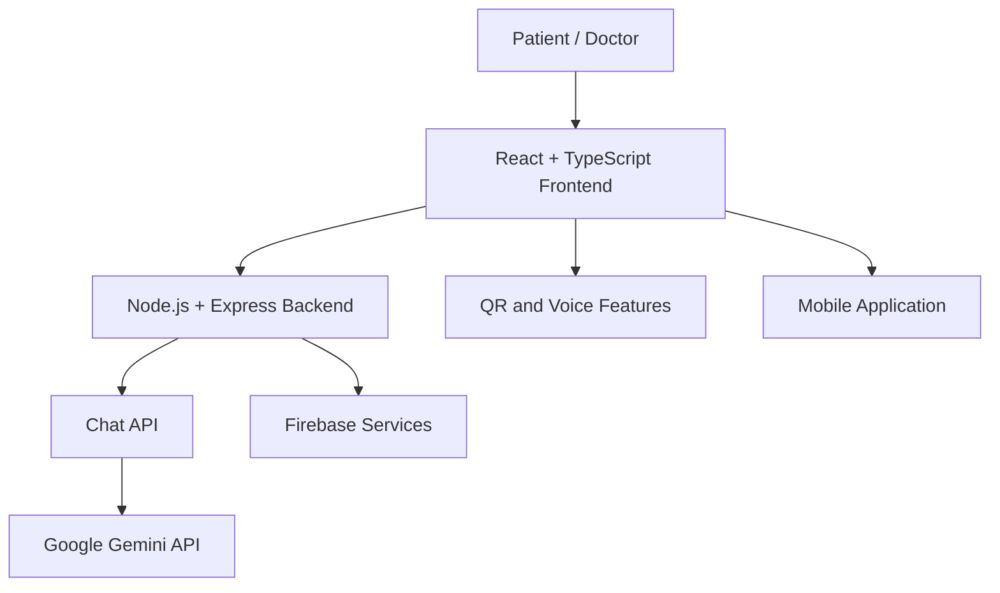
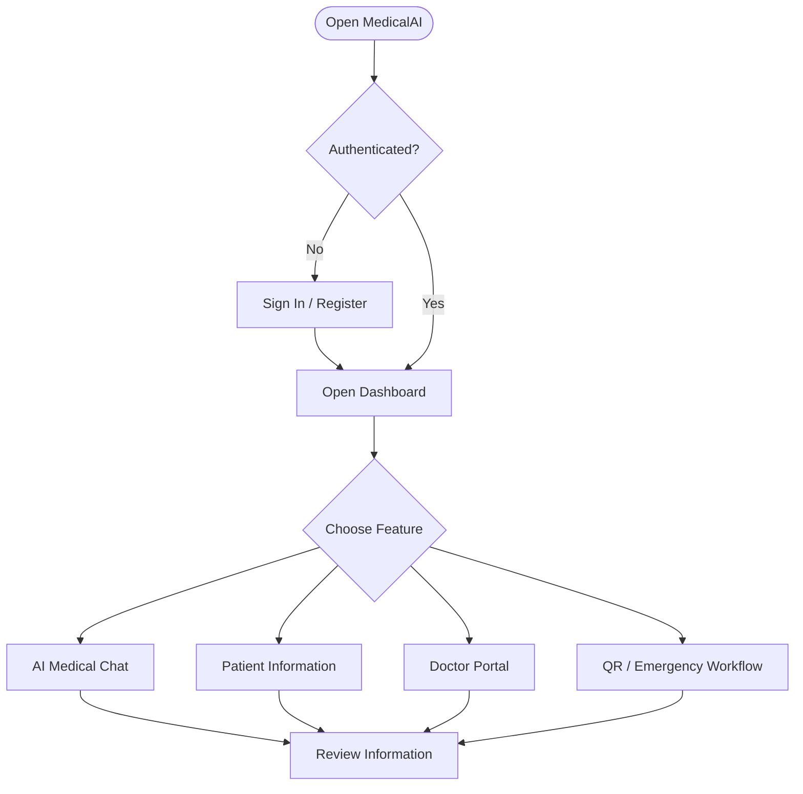
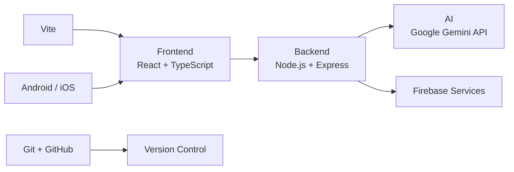

# MedicalAI 🏥
### AI-Assisted Clinical Intelligence & Preliminary Triage
**Smarter Care, Better Access.**

MedicalAI is an AI-powered healthcare platform designed to provide preliminary health information, AI-assisted triage, and organized patient information through a unified web and mobile experience.

[GitHub Repository](https://github.com/uiaryanyadav1109-dev/MedicalAI) · [Live Demo](https://medicalai-1.onrender.com/)

---

## 1. The Problem

- Healthcare information can be difficult to understand.
- Language barriers make health information less accessible.
- Patient information can be scattered across different sources.
- Users need convenient preliminary guidance before consulting healthcare professionals.

## 2. Our Solution

MedicalAI combines AI-assisted health conversations, patient-oriented interfaces, doctor-facing workflows, and multilingual accessibility in one platform.

## 3. Key Features

| Feature | Purpose |
|---|---|
| AI Medical Chatbot | Provides AI-assisted health information |
| Patient Portal | Organizes patient-facing healthcare information |
| Doctor Portal | Provides a dedicated doctor-oriented interface |
| Multilingual Support | Targets English, Hindi, Bengali, and Hinglish |
| Voice Assistance | Supports read-aloud functionality |
| Patient QR Codes | Supports patient identification and information-sharing workflows |
| Emergency Workflow | Provides an interface for emergency-related functionality |
| Mobile Support | Includes Android and iOS project components |

*Feature availability depends on the current implementation and configuration. AI guidance does not replace professional medical care.*

## 4. System Architecture



## 5. Application Flow



## 6. Technology Stack



- **Frontend:** React, TypeScript, Vite
- **Backend:** Node.js, Express.js
- **AI:** Google Gemini API
- **Authentication and data services:** Firebase, where configured
- **UI:** Tailwind CSS, Lucide React, Motion
- **QR codes:** QRCode / React QR Code
- **Version control:** Git and GitHub
- **Deployment:** Render configuration
- **Mobile:** Android and iOS project components

## 7. Project Structure

```text
MedicalAI/
├── src/             # Application source code
├── public/          # Static assets
├── docs/            # Documentation
├── scripts/         # Utility scripts
├── android/         # Android project
├── ios/             # iOS project
├── mobile-app/      # Mobile-related files
├── server.ts        # Express server entry point
├── package.json     # Dependencies and scripts
├── vite.config.ts   # Vite configuration
├── Dockerfile       # Container configuration
└── render.yaml      # Render deployment configuration
```

## 8. Run Locally

**Prerequisites:** Node.js, npm, Git, and the required AI/Firebase configuration.

```powershell
git clone https://github.com/uiaryanyadav1109-dev/MedicalAI.git
cd MedicalAI
npm ci
Copy-Item .env.example .env
```

Configure the required environment variables in `.env`, then run:

```powershell
npm run dev
```

Build and start the production-style application:

```powershell
npm run build
npm start
```

Check the backend health endpoint at `/health` on the configured server.

## 9. Challenges

- Integrating the AI service with the backend.
- Configuring authentication and Firebase services.
- Supporting multilingual and voice interactions.
- Coordinating web and mobile functionality.
- Testing features within a limited hackathon timeframe.

## 10. Future Scope

- Stronger role-based security and audit logs.
- Improved multilingual voice support.
- More comprehensive automated testing.
- Reliable, consent-based emergency communication.
- Further mobile optimization and deployment.

## Medical Disclaimer

MedicalAI provides AI-assisted health information and preliminary triage. It does not replace professional diagnosis or treatment. In an emergency, contact local emergency services.

---

**MedicalAI — Smarter Care, Better Access.**
