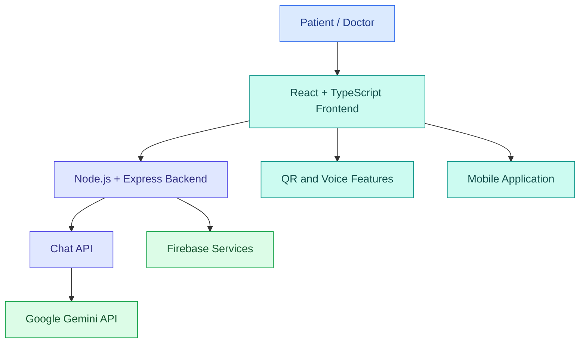
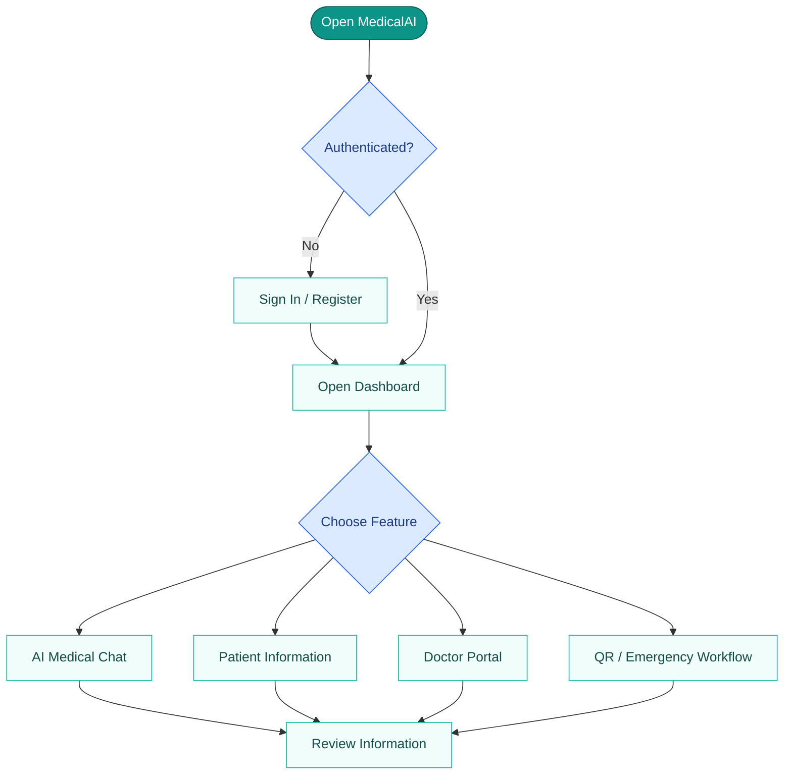

# 

### AI-Assisted Clinical Intelligence & Preliminary Triage

<p align="center">
  
  
  
</p>

<p align="center">
  An AI-assisted healthcare platform designed to make preliminary health information more accessible, support triage workflows, and organize patient information through a unified web and mobile experience.
</p>

<p align="center">
  <a href="https://github.com/uiaryanyadav1109-dev/MedicalAI">
    
  </a>
  <a href="https://medicalai-1.onrender.com/">
    
  </a>
</p>

---

## 🔵 01. The Problem

Healthcare information can be difficult to understand and access. Language barriers, scattered patient information, and limited access to preliminary guidance can make navigating healthcare more challenging.

- 🌐 Language differences can make health information harder to understand.
- 📂 Patient information may be scattered across different sources.
- 💬 Users may need help understanding basic health information before consulting a professional.
- ♿ Digital healthcare tools need to be accessible and easy to use.

## 🟢 02. Our Solution

MedicalAI brings together AI-assisted health conversations, patient-oriented interfaces, doctor-facing workflows, and multilingual accessibility in one platform.

Our goal is to explore how AI and full-stack development can support healthcare accessibility while keeping qualified medical professionals central to healthcare decisions.

## 🩺 03. Key Features

| Feature | Description |
|---|---|
| 🤖 AI Medical Chatbot | AI-assisted preliminary health information |
| 👤 Patient Portal | Patient-facing information and profile workflows |
| 🩺 Doctor Portal | A dedicated doctor-oriented interface |
| 🌐 Multilingual Support | Language support targeting English, Hindi, Bengali, and Hinglish |
| 🔊 Voice Assistance | Read-aloud functionality for accessibility |
| 🪪 Patient QR Codes | Patient identification and information-sharing workflows |
| 🚨 Emergency Workflow | Interface for emergency-related features |
| 📱 Mobile Support | Android and iOS project components |

<p align="center">
  
  
  
</p>

*Feature availability depends on the current implementation and configuration. AI guidance does not replace professional medical care.*

---

## 🏗️ 04. System Architecture



## 🔄 05. Application Flow



## 💻 06. Technology Stack

<p>
  
  
  
  
  
  
  
  
  
</p>

| Layer | Technologies |
|---|---|
| Frontend | React, TypeScript, Vite |
| Backend | Node.js, Express.js |
| AI | Google Gemini API |
| Authentication & data | Firebase, where configured |
| UI & animations | Tailwind CSS, Lucide React, Motion |
| QR codes | QRCode / React QR Code |
| Version control | Git and GitHub |
| Deployment | Render configuration |
| Mobile | Android and iOS project components |

## 📁 07. Project Structure

```text
MedicalAI/
├── src/             # Application source code
├── public/          # Static assets
├── docs/            # Documentation
├── scripts/         # Utility scripts
├── android/         # Android project
├── ios/             # iOS project
├── mobile-app/      # Mobile-related files
├── server.ts        # Express server entry point
├── package.json     # Dependencies and scripts
├── vite.config.ts   # Vite configuration
├── Dockerfile       # Container configuration
└── render.yaml      # Render deployment configuration
```

## ⚙️ 08. Run Locally

**Prerequisites:** Node.js, npm, Git, and the required AI/Firebase configuration.

**1. Clone the repository**

```powershell
git clone https://github.com/uiaryanyadav1109-dev/MedicalAI.git
cd MedicalAI
```

**2. Install dependencies**

```powershell
npm ci
```

**3. Configure environment variables**

```powershell
Copy-Item .env.example .env
```

Add the required environment variables to `.env`. Never commit secret API keys to GitHub.

**4. Start the development server**

```powershell
npm run dev
```

**5. Build and start the production-style application**

```powershell
npm run build
npm start
```

Check the `/health` endpoint on the configured backend URL to verify server health.

*Note: These commands assume the repository's `package.json` defines the listed scripts. Follow the repository configuration if any script differs.*

## 🧩 09. Challenges

- 🔌 Connecting AI services to the backend.
- 🔐 Configuring authentication and Firebase services.
- 🌐 Supporting multilingual and voice interactions.
- 📱 Coordinating web and mobile functionality.
- 🧪 Testing features and fixing issues within a limited hackathon timeframe.

## 🚀 10. Future Scope

- Stronger role-based security and audit logs.
- Improved multilingual voice support.
- More comprehensive automated testing.
- Reliable, consent-based emergency communication.
- Further mobile optimization and deployment.

---

## 🛡️ Medical Disclaimer

MedicalAI provides AI-assisted health information and preliminary triage support. It does not replace professional diagnosis or treatment. In an emergency, contact local emergency services.

<p align="center">
  
</p>

<h3 align="center">💙 MedicalAI — Smarter Care, Better Access.</h3>

<p align="center">
  <a href="https://github.com/uiaryanyadav1109-dev/MedicalAI">⭐ Explore the Repository</a>
  &nbsp;•&nbsp;
  <a href="https://medicalai-1.onrender.com/">🌐 Try the Live Demo</a>
</p>
