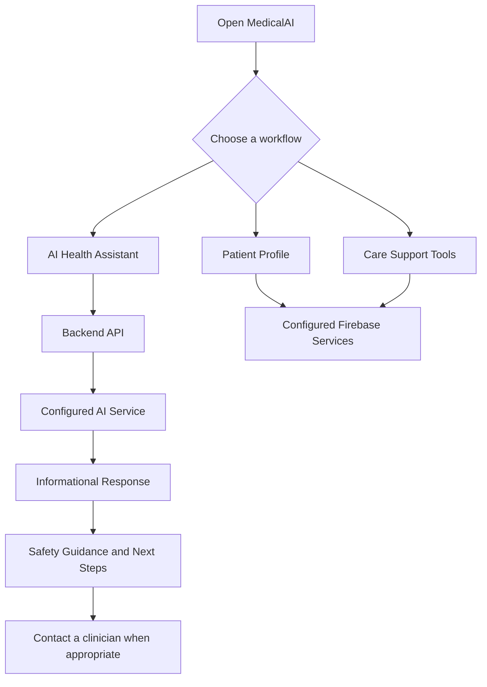
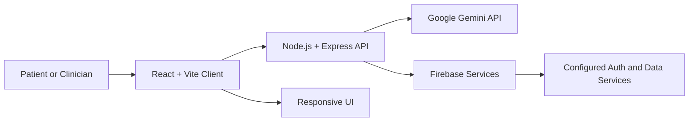

<div align="center">

# MedicalAI
### AI-Assisted Clinical Intelligence & Preliminary Triage

**A healthcare technology project for making health information easier to understand and care workflows easier to organize.**

[](https://react.dev/)
[](https://vite.dev/)
[](https://nodejs.org/)
[](https://expressjs.com/)
[](https://firebase.google.com/)
[](https://ai.google.dev/)

[Repository](https://github.com/uiaryanyadav1109-dev/MedicalAI) · [Issues](https://github.com/uiaryanyadav1109-dev/MedicalAI/issues) · [Contribute](https://github.com/uiaryanyadav1109-dev/MedicalAI/issues)

</div>

---

## Overview

**MedicalAI** is an AI-assisted healthcare platform concept that brings preliminary health information, patient details, and care-support workflows into one digital experience. The project combines a modern web interface with backend APIs, AI integration, and Firebase-based services where configured.

The aim is to make health information easier to navigate and help users organize relevant care information—not to replace clinicians or emergency services.

> **Medical disclaimer:** MedicalAI is not a medical device or a substitute for professional medical advice, diagnosis, or treatment. AI-generated content may be inaccurate. Do not use it to make urgent or high-stakes medical decisions.

## Features

| Capability | Purpose |
|---|---|
| AI health assistant | Ask health-related questions and receive general informational responses |
| Preliminary symptom guidance | Organize reported symptoms into non-diagnostic information |
| Patient profile | Keep relevant profile and health details organized |
| Patient ID and QR workflows | Support quick access to selected patient information |
| Emergency support concept | Support an SOS flow and location sharing where implemented and configured |
| Medication reminders | Help users track scheduled reminders where implemented |
| Doctor portal | Support a more structured patient-care workflow where implemented |
| Accessibility direction | Multilingual and voice-oriented interaction goals |
| Responsive experience | Build toward usability across screen sizes and devices |

**Feature status:** Availability depends on the current code and deployment configuration. Treat features as implemented only after verifying them in the repository and testing them end to end.

## Why MedicalAI?

- **Connected workflows:** bring health guidance and care-support tools together.
- **AI-assisted interaction:** integrate natural-language responses through a configured AI service.
- **Patient-centered design:** organize relevant information in a more accessible experience.
- **Designed to evolve:** keep UI, API, AI, and data responsibilities separated where the repository architecture supports it.
- **Safety-aware direction:** make it clear that AI output is informational and does not replace qualified care.

## User Workflow



## Architecture



The diagram is a conceptual view of the intended stack. Confirm the actual integrations and data flow in the current source code before treating every connection as implemented.

## Technology Stack

| Layer | Technology | Role |
|---|---|---|
| Frontend | React and Vite | User interface and client-side workflows |
| Backend | Node.js and Express | API routes and server-side operations |
| AI | Google Gemini API | AI-assisted natural-language responses, if enabled |
| Authentication/data | Firebase services | Identity and data capabilities, depending on configuration |
| Version control | Git and GitHub | Source control and collaboration |
| Deployment | Render or another configured host | Hosting, depending on the active deployment |

Check the repository's `package.json` files and source code for the exact versions and packages currently in use.

## Getting Started

### Prerequisites

- [Node.js](https://nodejs.org/) and npm
- [Git](https://git-scm.com/)
- A Google AI Studio API key if Gemini-powered features are enabled
- A Firebase project if the application uses Firebase services

Verify the installations in **Windows PowerShell**:

```powershell
node --version
npm --version
git --version
```

### 1. Clone the repository

```powershell
git clone https://github.com/uiaryanyadav1109-dev/MedicalAI.git
Set-Location MedicalAI
```

### 2. Install dependencies

Inspect the repository's folder structure and `package.json` files first. If the repository uses a single root package, install from the root:

```powershell
npm install
```

If the frontend and backend are separate applications with their own `package.json` files, install in each folder instead. For example, **only if these folders exist**:

```powershell
Set-Location .\frontend
npm install
Set-Location ..\backend
npm install
Set-Location ..
```

Use the layout that matches the repository; do not run both approaches blindly.

### 3. Configure environment variables

Check the source code and any `.env.example` files for the exact variable names expected by the application. The following are examples, not a guarantee of the current configuration.

**Backend `.env` example**

```dotenv
PORT=5000
GEMINI_API_KEY=replace_with_your_key
```

**Vite frontend `.env` example**

```dotenv
VITE_API_BASE_URL=http://localhost:5000
```

Vite exposes variables prefixed with `VITE_` to client-side code. **Never put private API keys or service-account credentials in a `VITE_` variable.** Keep Gemini secrets on the server and use the exact environment-variable names read by your code.

Security basics:

- Keep `.env` files and service-account JSON files out of Git.
- Add secrets to the hosting provider's environment settings, not to source code.
- If a secret is accidentally committed, revoke or rotate it immediately.
- Firebase client configuration is not a replacement for database security rules or backend authorization.

### 4. Run locally

Run the scripts defined in each `package.json`. For a typical Vite frontend, the command is often:

```powershell
npm run dev
```

For a typical Express backend, use the development script declared by that backend—often `npm run dev` or `npm start`.

If frontend and backend are separate apps, start them in separate PowerShell terminals from their respective directories. Open the local URL printed by the frontend development server.

### 5. Build and test

From the relevant application directory, run the scripts that actually exist in `package.json`:

```powershell
npm run build
npm run lint
npm test
```

These are common script names; some repositories do not define all of them. Check the available scripts before running them.

## Deployment Checklist

For a split frontend/backend deployment:

1. **Frontend:** set the production API base URL, build the app, and deploy the generated frontend output to a compatible host.
2. **Backend:** deploy the Express app to a Node-compatible host and configure server-side environment variables.
3. **Firebase:** configure authorized domains, enabled sign-in providers, and restrictive security rules.
4. **AI service:** add the Gemini API key to the backend host's secret settings.
5. **CORS:** allow only the website origins that should access the API.
6. **End-to-end tests:** verify login, API requests, AI responses, patient-data permissions, QR sharing, and SOS behavior where implemented.
7. **Logs:** ensure logs and error messages do not expose credentials or sensitive health information.

A deployed frontend does not automatically mean the API, authentication, database, or AI service is configured correctly. Test each service independently.

## Privacy, Security & Medical Safety

Health information is sensitive. Before using real patient data, conduct appropriate privacy, security, and clinical review.

- Collect only information needed for a clear purpose.
- Enforce authentication and authorization on every protected API and record.
- Apply least-privilege database rules and validate inputs on the server.
- Use HTTPS in deployed environments and review retention and deletion behavior.
- Avoid placing sensitive health details in URLs, analytics, screenshots, or logs.
- Ensure QR links expose only information the patient has authorized to share.
- Clearly identify AI-generated content and communicate its limitations.
- Do not rely on MedicalAI for emergency response, diagnosis, or treatment decisions.

This project README does not claim clinical validation, regulatory approval, or certification.

## Repository Structure

The actual structure may differ. Use the repository itself as the source of truth; the following is illustrative only:

```text
MedicalAI/
├── frontend/        # React + Vite client, if separated
├── backend/         # Express API, if separated
├── android/         # Android project, if present
├── public/          # Static assets, depending on layout
├── .env.example     # Safe environment template, if maintained
├── .gitignore
└── README.md
```

## Contributing

Contributions, bug reports, and practical improvements are welcome.

1. Fork the repository.
2. Create a focused branch:

   ```powershell
   git checkout -b feat/your-feature
   ```

3. Make your changes and test them locally.
4. Commit with a descriptive message:

   ```powershell
   git add .
   git commit -m "feat: describe your change"
   ```

5. Push the branch and open a pull request.

Do not include real patient records, identifiable health information, API keys, or private credentials in commits, issues, screenshots, or test fixtures.

## Roadmap

Potential next steps for the project:

- [ ] Harden authentication and role-based access control
- [ ] Add automated tests for API routes and critical user journeys
- [ ] Improve multilingual and accessible voice interaction
- [ ] Validate consent-based patient QR sharing
- [ ] Test medication reminders and emergency workflows on real devices
- [ ] Document production deployment and mobile build steps
- [ ] Complete privacy, security, and clinical review before real-world use

## Links

- **GitHub repository:** [uiaryanyadav1109-dev/MedicalAI](https://github.com/uiaryanyadav1109-dev/MedicalAI)
- **Google AI for Developers:** https://ai.google.dev/
- **Node.js:** https://nodejs.org/
- **Express:** https://expressjs.com/
- **Firebase:** https://firebase.google.com/

## License

Check whether the repository contains a `LICENSE` file. If it does not, do not assume that the project is open-source licensed; all rights remain with the copyright holder unless a license is explicitly granted.

---

<div align="center">

**MedicalAI — clearer health information, more organized care workflows.**

If you find this project useful, consider starring the repository and sharing feedback through GitHub Issues.

</div>
